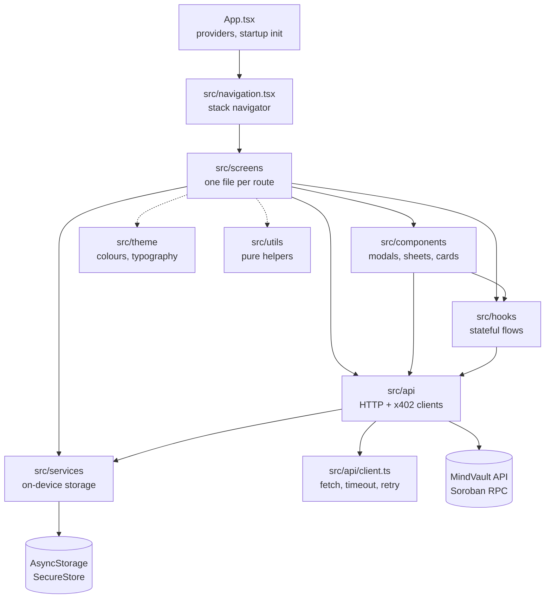
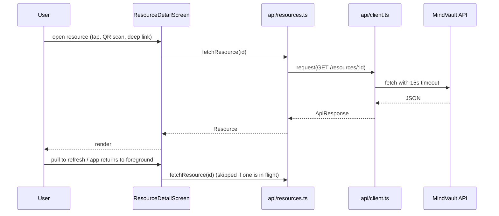
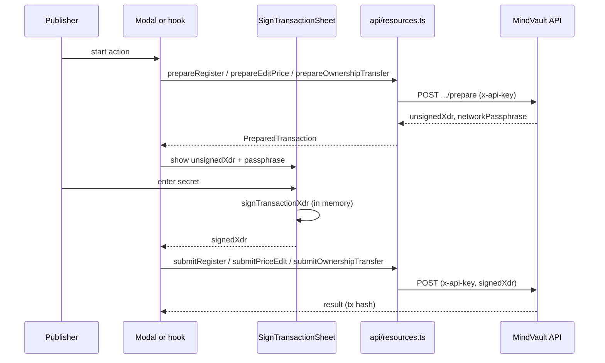
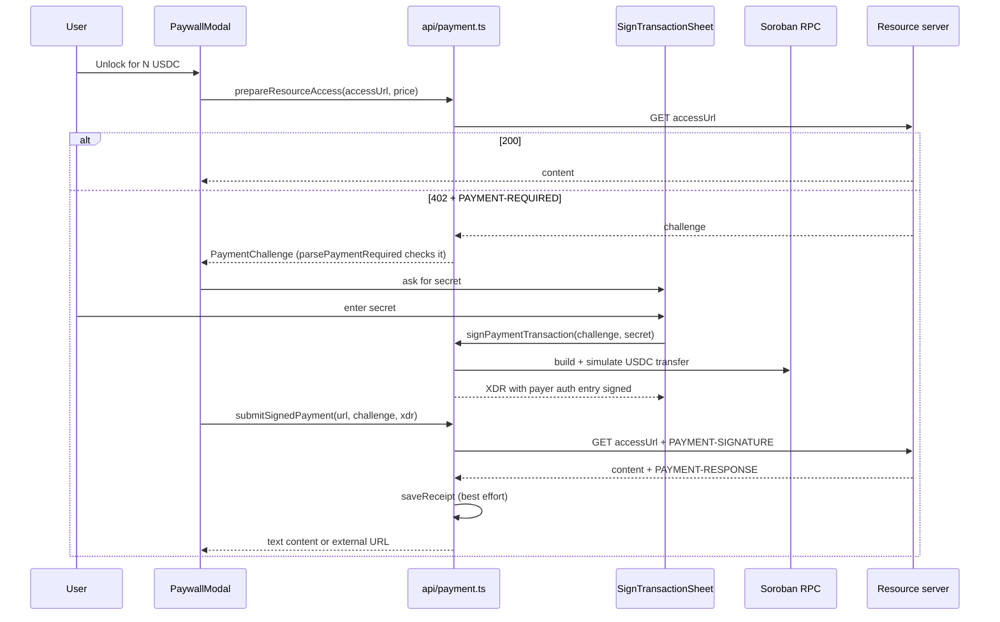

# Architecture

A map of the MindVault mobile app for new contributors. It is an Expo / React
Native app (TypeScript) that browses payment-protected resources on Stellar.
There is no global state library: screens own their state with React hooks and
talk to the MindVault API through thin modules in `src/api`.

## Layers

| Layer | Path | Responsibility |
| --- | --- | --- |
| Entry | `App.tsx` | Wraps the app in `SafeAreaProvider`, `ThemeProvider` and `ErrorBoundary`. Loads the saved API base URL (`initializeApiBaseUrl`) and theme before rendering anything themed. Shows `OfflineBanner` from `useNetworkStatus`. Mounts `NavigationContainer` with the deep-link config. |
| Navigation | `src/navigation.tsx`, `src/linking.ts` | Native stack with `RootStackParamList` (Catalog, ResourceDetail, Scanner, Settings, PublisherResources, PublisherProfile, PublisherAnalytics, PurchaseHistory, and `DevSigner` in `__DEV__` only). `linking.ts` maps `mindvault://` and `https://<api-host>/resources/:id` links to ResourceDetail via `parseResourceId`. |
| Screens | `src/screens` | One component per route. Fetch data, hold view state, compose components. |
| Components | `src/components` | Reusable UI: `ResourceCard`, `StatusBadge`, `PaywallModal`, `RegisterModal`, `TransferOwnershipModal`, `SignTransactionSheet`, banners and skeletons. |
| Hooks | `src/hooks` | Reusable stateful logic: `useNetworkStatus` (NetInfo, `onReconnect`), `useAppForeground` (AppState, refetch on return to foreground), `useEditPrice`, `useTransferOwnership`. |
| API | `src/api` | Everything that talks to the network. `client.ts` is the single `fetch` wrapper; `resources.ts`, `publishers.ts`, `verification.ts` are endpoint modules; `payment.ts` is the x402 client; `apiSettings.ts` validates and persists the base URL. |
| Services | `src/services` | On-device persistence and support tooling: `secureStorage`, `receipts`, `recent`, `diagnostics`. |
| Theme | `src/theme` | `useTheme` hook (persisted mode), `ThemeProvider`, colour tokens, shared styles. |
| Utils | `src/utils` | Pure helpers: link parsing, Stellar Expert URLs, secret validation, price ranges, receipt export, the redacting error logger. |

Dependencies point downward: screens and components may use hooks, api, services
and utils; `api` may use `services` and `utils`; `services` and `utils` never
import from screens or components.

## Data flow

Read path, using the resource detail screen as the example:

- `request()` in `src/api/client.ts` throws a typed `ApiError`
  (`network`, `timeout`, `aborted`, `http`). GET requests retry network errors
  and 5xx responses twice with exponential backoff. POST and DELETE are never
  retried, because a retry could repeat a side effect.
- `fetchResource` wraps failures in `ResourceFetchError`, which carries
  `isTransient` so the screen can offer "Try Again".
- The API base URL is a module-level value in `src/api/resources.ts`, set at
  startup by `initializeApiBaseUrl()` and changed from Settings with
  `setApiBaseUrl()`.
- Publisher endpoints go through `publisherFetch`, which reads the API key from
  secure storage, sends it as `x-api-key`, and redacts it from error messages.
- The catalog screen records opened resources with `recordRecentResource`, and
  restores its filters from AsyncStorage.
- Background refreshes (pull to refresh, `useAppForeground`) keep the current
  content on screen and ignore failures; only one request is in flight at a time.

## State and storage map

State is local to each screen. Anything that must outlive the app is in one of
two stores. Keys are listed here so you can find and clear them while debugging.

### AsyncStorage (not secret)

| Key | Owner | Contents |
| --- | --- | --- |
| `mindvault_api_base_url` | `src/api/apiSettings.ts` | The user's API base URL override. Removed when reset to the default. |
| `@mindvault_theme_mode` | `src/theme/index.ts` | `light`, `dark` or `system`. |
| `@mindvault_catalog_filters` | `src/screens/CatalogScreen.tsx` | JSON of the saved catalog search and filters. |
| `@mindvault_recent_resources` | `src/services/recent.ts` | JSON list of recently viewed resources, capped at `MAX_RECENT_RESOURCES` (20). |
| `@mindvault_receipts` | `src/services/receipts.ts` | JSON `{ version, receipts }` of payment receipts, capped at `MAX_RECEIPTS` (200). |

### SecureStore (Keychain / Keystore)

| Key | Owner | Contents |
| --- | --- | --- |
| `x-api-key` | `src/services/secureStorage.ts` | The publisher API key. |
| `biometric-lock-enabled` | `src/services/secureStorage.ts` | `"true"` when the user opted in to Face ID / fingerprint. Absent means off. |

When the biometric preference is on, `getApiKey()` calls
`expo-local-authentication` before reading the key. If the device has no
biometric hardware or enrolment, it falls back to reading the key without a
prompt, and `setBiometricLockEnabled(true)` refuses to turn the option on.
A cancelled or failed prompt throws `SecureStorageError`.

Failures in `secureStorage` throw `SecureStorageError` with a fixed message and
log through the redacting `logError`; the key never appears in a message.

### Never stored

The Stellar secret key (`S…`) is typed into `SignTransactionSheet`, used in
memory for one signature, and cleared on success, error, cancel and unmount.
It is never written to either store or logged.

## Signing and payment flows

The app never holds a wallet. Anything that needs a signature goes through the
shared `SignTransactionSheet`, which validates the secret, shows the network
passphrase (with a warning on test networks), signs, and clears the secret.
`SIGNING_STRATEGY.md` describes the longer-term WalletConnect plan; today's
in-app signer is the sheet.

### Publisher transactions (register, edit price, transfer ownership)

The passphrase used to sign comes from the backend's `prepare` response; the
`app.json` value is only the fallback.

### Paying for a resource (x402 v2)

Full detail is in [PAYMENTS.md](./PAYMENTS.md).

Safety rules enforced in `payment.ts`: only the `exact` scheme on the app's
network, only an amount at or below the price the user saw, only fee-sponsored
challenges, and only the payer's authorization entry is signed. A receipt that
fails to save never causes a retry, so a payment cannot be charged twice.

## Where to look when you...

| Want to | Start at |
| --- | --- |
| Add a screen | `src/navigation.tsx` (route + params), then `src/screens` |
| Add an endpoint | `src/api/resources.ts` (use `request` or `publisherFetch`) |
| Persist something | `src/services`; use SecureStore only for secrets |
| Change deep links | `src/linking.ts`, [UNIVERSAL_LINKS.md](./UNIVERSAL_LINKS.md) |
| Write tests | [TESTING.md](./TESTING.md) |
